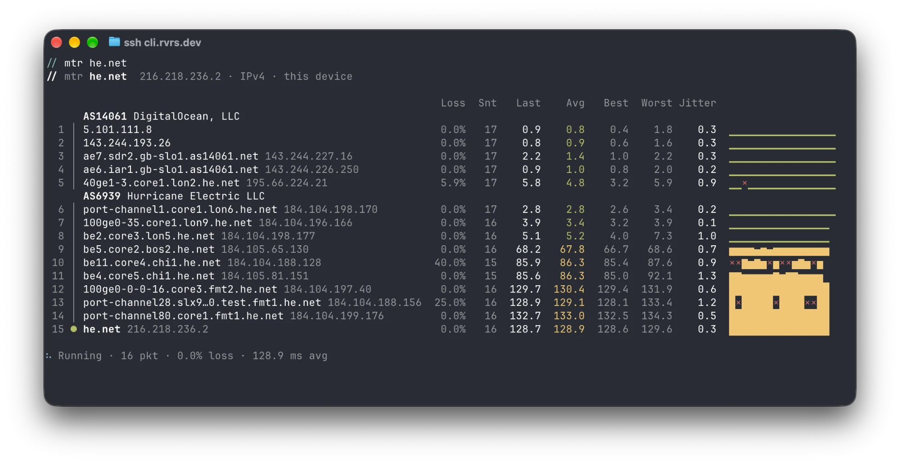
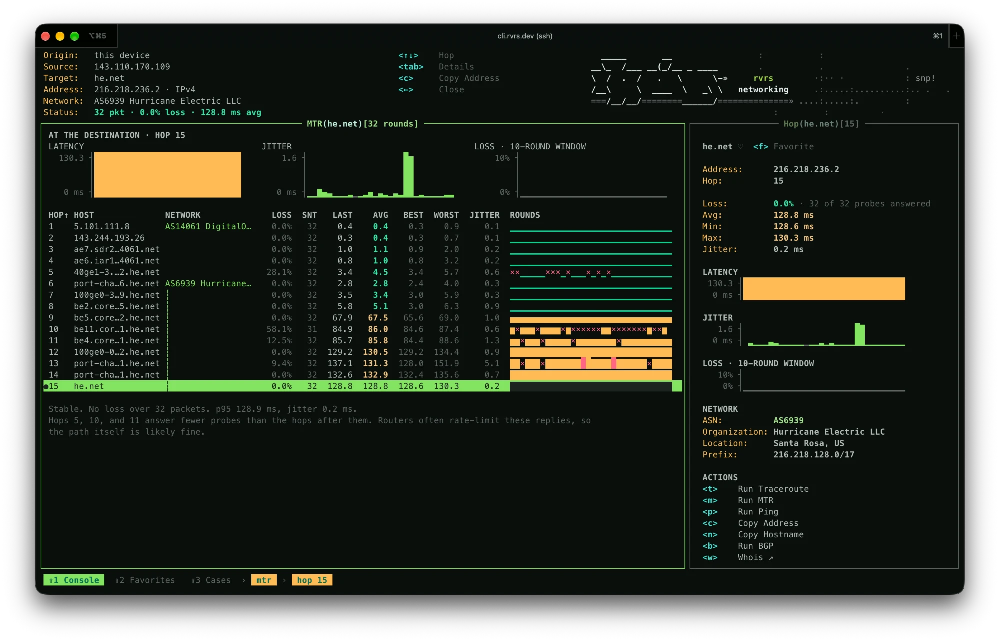

<div align="center">

<picture>
  <source media="(prefers-color-scheme: dark)" srcset="docs/images/mark-dark.svg">
  
</picture>

<b>See what the network is doing, on your terminal - from any node.</b>

<a href="#screenshots">Terminal UI</a> and drop-in replacement for traceroute, ping, MTR, dig and BGP in one binary.<br>
Soon with support for remote nodes.

<sub>Try it live</sub>

```bash
ssh cli.rvrs.dev
```

</div>



## Tools

| Command | Shows |
| --- | --- |
| [`rvrs traceroute <target>`](docs/traceroute.md) | The path to a target, with each hop's network |
| [`rvrs ping <target>`](docs/ping.md) | Latency and loss, packet by packet |
| [`rvrs mtr <target>`](docs/mtr.md) | Loss and latency at every hop, round after round |
| [`rvrs dig <name>`](docs/dig.md) | Your resolver, three public resolvers and the zone's own servers, compared |
| [`rvrs bgp <target>`](docs/bgp.md) | Who announces a route, its RPKI result and the AS paths collectors see |
| [`rvrs`](docs/console.md) | The Console, all of the above in one terminal UI |

## Install

```bash
curl -fsSL https://rvrs.dev/install.sh | sh
```

```bash
brew install rvrs-dev/tap/rvrs
```

Runs on macOS and Linux, without root. Every [release](https://github.com/rvrs-dev/cli/releases) also has a `.deb` and an `.rpm`. Update with `rvrs update`.

From source, with Rust 1.82 or newer:

```bash
cargo build --release
```

## Use it as traceroute, ping, mtr and dig

```bash
curl -fsSL https://rvrs.dev/install.sh | sh -s -- --link
```

Under those names rvrs prints what the originals print, so scripts keep working. `~/.local/bin` has to come before `/usr/bin` on your `PATH`.

To switch back:

```bash
rm ~/.local/bin/traceroute ~/.local/bin/ping ~/.local/bin/mtr ~/.local/bin/dig
```

## Screenshots

The Console, during an MTR to he.net:



## For agents

```bash
npx skills add rvrs-dev/cli
```

A skill that teaches an AI agent to diagnose a network with rvrs: runs with a fixed count read as JSON, compared with the history rvrs keeps. [rvrs for agents](docs/agents.md) has the Claude Code plugin and what the skill does.

## Privacy

rvrs has no account and sends no usage data. [Privacy](docs/privacy.md) lists every request it makes.

## Docs

- [traceroute](docs/traceroute.md), [ping](docs/ping.md), [mtr](docs/mtr.md), [dig](docs/dig.md), [bgp](docs/bgp.md)
- [The Console](docs/console.md)
- [Commands](docs/commands.md), including history, saved runs and `--json`
- [rvrs for agents](docs/agents.md)
- [Privacy](docs/privacy.md)

## License

Licensed under either of [Apache License, Version 2.0](LICENSE-APACHE) or [MIT license](LICENSE-MIT), at your option.

Unless you explicitly state otherwise, any contribution intentionally submitted for inclusion in rvrs by you, as defined in the Apache-2.0 license, shall be dual licensed as above, without any additional terms or conditions.
